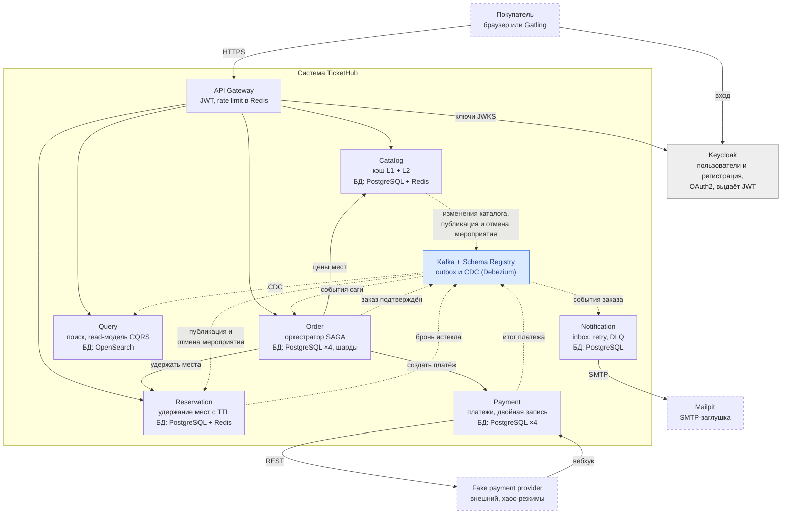
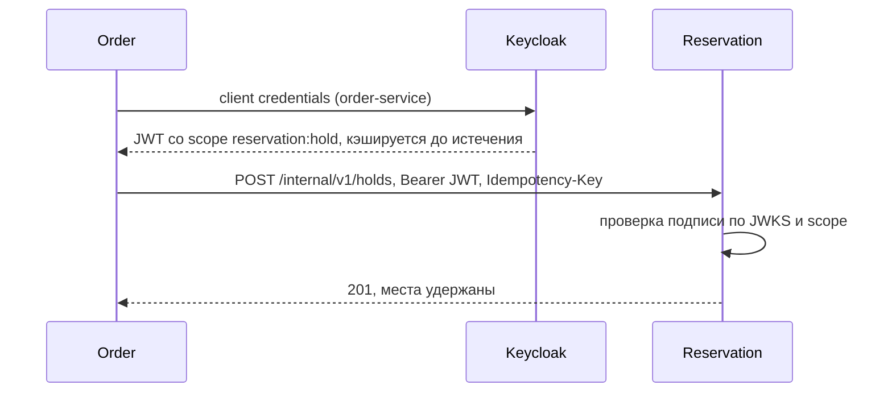
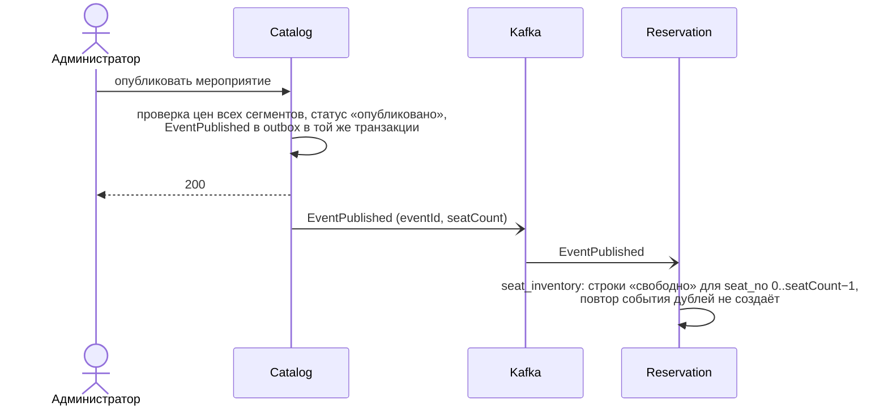
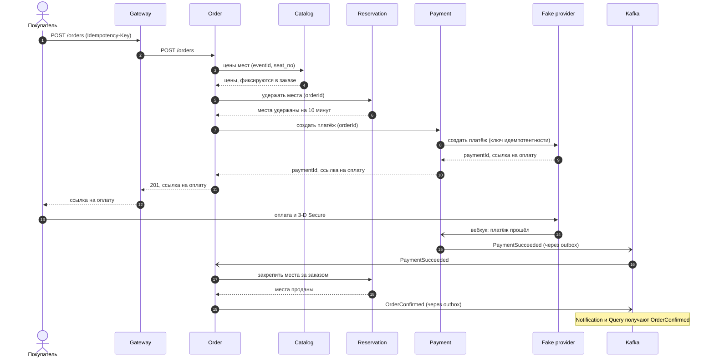

# Архитектура TicketHub

Синхронный вызов стоит там, где пользователь ждёт ответа; всё остальное идёт событиями через Kafka. У каждого сервиса своя база данных, чужую БД напрямую никто не читает. Решения, стоящие за этой схемой, — в [ADR-003](adr/0003-purchase-saga-orchestration.md) и в списке ADR в [plan.md](plan.md).

## Контейнеры (C4, уровень 2)

Сплошная стрелка — синхронный вызов (HTTPS или REST), пунктирная — асинхронное событие через Kafka. Пунктирная рамка — внешняя система или заглушка. Все сервисы написаны на Java 25 и Spring Boot 4, на сервлетном стеке с виртуальными потоками, без реактивного программирования ([ADR-013](adr/0013-servlet-stack.md)). Каждый сервис рассчитан на работу в нескольких экземплярах: состояние хранится в БД и Redis, задачи по расписанию и outbox publisher в каждый момент выполняются одним экземпляром (ShedLock). Они отправляют метрики, трейсы и логи по OTLP в OpenTelemetry Collector, откуда они попадают в Grafana (Prometheus, Tempo, Loki).

## Синхронно или через Kafka

Критерий один: нужен ли вызывающему ответ прямо сейчас, чтобы ответить пользователю. Если пользователь ждёт, а операция быстрая, вызов синхронный. Если результат по природе приходит позже или это побочный эффект, это событие.

| Шаг | Как | Почему |
| --- | --- | --- |
| Клиент → Catalog, Reservation: карта зала | REST | Пользователь ждёт карту. Схема и цены приходят из Catalog через кэш, статусы мест — из Reservation по `seat_no` без кэша |
| Клиент → Order: создать заказ | REST + Idempotency-Key | Пользователь ждёт номер заказа |
| Catalog → Reservation: мероприятие опубликовано | Событие в Kafka | Reservation создаёт строки мест мероприятия до начала продаж, никто не ждёт ([ADR-018](adr/0018-seat-ownership.md)) |
| Order → Catalog: цены мест | Синхронно, REST, `/internal` без кэша | Цена фиксируется в заказе в момент создания, пользователь ждёт сумму ([ADR-018](adr/0018-seat-ownership.md), [ADR-020](adr/0020-endpoint-groups.md)) |
| Order → Reservation: удержать места | Синхронно, REST | Нужен немедленный ответ, операция быстрая |
| Order → Payment: создать платёж | Синхронно, REST | Клиенту нужна ссылка на оплату |
| Payment → провайдер | Синхронно, HTTP | Так устроены API провайдеров |
| Провайдер → Payment: итог платежа | Вебхук | 3-D Secure и банк отвечают не сразу |
| Payment → Order: платёж прошёл или нет | Событие в Kafka | Результат пришёл позже, Order продолжает сагу |
| Reservation → Order: бронь истекла | Событие в Kafka | Происходит по таймеру, а не по запросу |
| Order → Notification, Query | События в Kafka | Побочные эффекты, никто не ждёт |
| Catalog → Order, Reservation: мероприятие отменено | Событие в Kafka | Администратор не ждёт отмены тысяч заказов; Order оркеструет отмену ([ADR-012](adr/0012-event-cancellation-orchestration.md)), Reservation перестаёт удерживать места |
| Order → Reservation, Payment: освободить места, вернуть деньги | Синхронно, REST | Компенсация саги: Order должен знать результат каждого шага |

Каждый синхронный вызов внутри саги идёт с ключом идемпотентности (`orderId`), таймаутом и повтором. Если вызов упал по таймауту и исход неизвестен, Order повторяет его с тем же ключом или запрашивает статус.

## Безопасность

Keycloak выдаёт токены двум видам клиентов: пользователям и сервисам. Он же — единственное хранилище пользователей: регистрация идёт через self-registration Keycloak, отдельного сервиса пользователей нет ([ADR-017](adr/0017-keycloak-as-user-store.md)). Сервисы хранят только userId (`sub` из JWT). Email Order сохраняет в заказе как снимок из токена и передаёт в событиях заказа, поэтому Notification к Keycloak не обращается.

| Кто | Как получает токен | Что в токене |
| --- | --- | --- |
| Пользователь (браузер, Gatling) | Authorization Code + PKCE; в тестах — password grant | `sub` = userId, `email`, роль `customer` или `admin` |
| Сервис (Order, Payment) | Client credentials | `azp` = имя сервиса, scopes вида `reservation:hold`, `payment:create`, `catalog:prices` |

Межсервисный вызов идёт с токеном вызывающего сервиса, а не пользователя: шаги саги часто запускаются событием из Kafka или по расписанию, когда пользовательского токена нет. Принимающий сервис проверяет подпись токена по JWKS Keycloak и нужный scope. userId передаётся в теле запроса как данные, а не как личность вызывающего.

| Уровень защиты | Как | Этап |
| --- | --- | --- |
| Доступ к БД | Отдельная база и отдельный пользователь PostgreSQL для каждого сервиса | 1 |
| Группы эндпоинтов | Правила доступа по префиксу пути: `/api`, `/admin`, `/internal` | 3 |
| Внутренние эндпоинты снаружи | Gateway не проксирует `/internal/**` | 8 |
| Пользователь → сервисы | JWT пользователя из Keycloak | 3 |
| Сервис → сервис | JWT client credentials + проверка scope | 3 |
| Провайдер → Payment | HMAC-подпись вебхука, проверка срока давности | 5 |
| Шифрование на входе | HTTPS на Gateway | 8 |
| Шифрование между сервисами | mTLS через service mesh (Linkerd), опционально | 10 |

Внутри Docker-сети сервисы общаются по HTTP без TLS. Это осознанный компромисс: шифрование между сервисами в реальных системах обеспечивает инфраструктура (service mesh), а не код приложения, а права каждого сервиса и так ограничены scopes его токена.

### Группы эндпоинтов

Эндпоинты сервиса делятся по префиксу пути ([ADR-020](adr/0020-endpoint-groups.md)). Правила доступа задаются шаблонами путей, поэтому новый эндпоинт защищён по умолчанию.

| Префикс | Кто вызывает | Через Gateway | Авторизация |
| --- | --- | --- | --- |
| `/api/v1/...` | Покупатель | Да | JWT пользователя, роль `customer`; чтение афиши — анонимно |
| `/admin/v1/...` | Администратор | Да | JWT пользователя, роль `admin` |
| `/internal/v1/...` | Сервисы TicketHub | Нет | JWT client credentials и scope |
| `/webhooks/...` | Fake provider → Payment | Нет | HMAC-подпись |

| Сервис | `/api` | `/admin` | `/internal` |
| --- | --- | --- | --- |
| Catalog | Афиша, схема зала, цены (через кэш) | Площадки, схемы залов, мероприятия, цены, публикация, отмена | Цены мест для Order, из БД без кэша (`catalog:prices`) |
| Reservation | Статусы мест для карты зала | — | Удержать, закрепить, освободить места (`reservation:hold`) |
| Order | Создать заказ, мои заказы | — | — |
| Payment | — | — | Создать платёж, возврат (`payment:create`) |

Цены — пример того, зачем группы разделены не только ради доступа: клиенту для карты зала подходит цена из кэша, а Order фиксирует цену в заказе и получает точную из БД.

## Сервисы

| Сервис | Отвечает за | Хранилище | Как общается |
| --- | --- | --- | --- |
| API Gateway | Маршрутизация, проверка JWT, rate limiting; Spring Cloud Gateway Server Web MVC | Redis (счётчики лимитов) | REST от клиентов; проксирует `/api/**` и `/admin/**` в Catalog, Reservation, Order, Query, но не `/internal/**` |
| Catalog | Мероприятия, площадки, неизменяемые схемы залов с местами, цены сегментов ([ERD](catalog/erd.md)) | PostgreSQL + кэш Caffeine/Redis | REST от клиентов и Order; публикует изменения каталога, публикацию и отмену мероприятия в Kafka |
| Reservation | Состояние мест (свободно, удержано, продано), удержание с TTL, защита от двойной продажи | PostgreSQL + Redis (holds, Lua) | REST от Gateway и Order; публикует событие «бронь истекла»; слушает публикацию и отмену мероприятия |
| Order | Заказы и зафиксированные в них цены, оркестрация SAGA покупки и отмены мероприятия | PostgreSQL, 2–4 шарда по user_id | REST; синхронно вызывает Catalog, Reservation и Payment; события через outbox |
| Payment | Платежи, возвраты, проводки по двойной записи | PostgreSQL, шарды + реплика | REST от Order; синхронно вызывает провайдера, принимает вебхуки; публикует итог платежа |
| Notification | Письма и пуши | PostgreSQL (inbox) | Только Kafka; SMTP в Mailpit |
| Query | Поиск мероприятий, история заказов (CQRS) | OpenSearch | REST; читает CDC из Kafka |
| Fake payment provider | «Злой» внешний провайдер с хаос-режимами | В памяти | REST от Payment, вебхуки в Payment |

Общая инфраструктура: Kafka со Schema Registry (Apicurio), Kafka Connect с Debezium для outbox и CDC, Keycloak для аутентификации и хранения пользователей, OpenTelemetry Collector и стек Grafana (Prometheus, Tempo, Loki). Оплата только картой через провайдера, собственного кошелька нет.

## Места: кто чем владеет

Подробности и отвергнутые варианты — в [ADR-018](adr/0018-seat-ownership.md).

| Что | Владелец | Как узнают остальные |
| --- | --- | --- |
| Какие места есть у мероприятия, ряд, сектор, координаты на схеме | Catalog | Reservation получает число мест из `EventPublished`; клиент читает схему с `seat_no` из Catalog |
| Свободно, удержано или продано | Reservation | Клиент и Order спрашивают Reservation; Catalog о занятости не знает |
| Цена места | Catalog, пока заказ не создан | Order получает цены синхронно и фиксирует их в заказе |
| Цена в заказе | Order | Payment получает сумму от Order |

- Место между сервисами идентифицируется парой `(event_id, seat_no)`. `seat_no` — технический сквозной номер внутри схемы зала от 0 до N−1, его присваивает Catalog при создании схемы. Это не номер места на билете: соответствие «`seat_no` ↔ сектор, ряд, место» знает только Catalog.
- Мероприятие продаёт все места своей схемы зала. Схема неизменна, пока на неё ссылается опубликованное мероприятие; изменённый зал или закрытые места — это новая схема. События об изменении мест нет.
- Поддерживаются только места с рассадкой, зон без мест (танцпол) нет.

## Покупка билета: успешный сценарий

Шаги 1–12 синхронные: пользователь ждёт ссылку на оплату. Дальше процесс идёт по событиям: итог платежа приходит, когда его пришлёт провайдер, и Order завершает сагу уже без участия пользователя. Сценарии отказа (платёж отклонён, провайдер не ответил, бронь истекла) — диаграммы в разделах проектирования этапов Order и Payment в [plan.md](plan.md).
