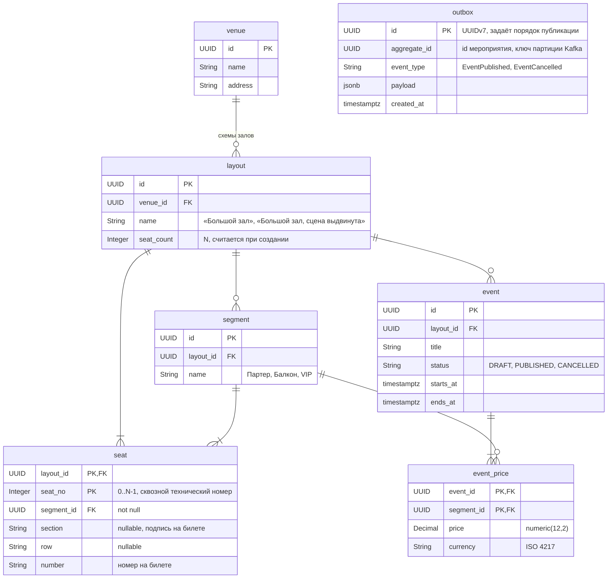

# ERD Catalog

Таблицы Catalog: площадки, схемы залов, места, мероприятия и цены. Кто чем владеет между сервисами — в [architecture.md](../architecture.md), раздел «Места: кто чем владеет».

## Сущности

| Таблица | Что хранит |
| --- | --- |
| `venue` | Площадка: название и адрес |
| `layout` | Схема зала площадки. Одна площадка может иметь несколько схем: разные залы или один зал в разных конфигурациях |
| `segment` | Ценовая зона схемы: «Партер», «Балкон», «VIP». Сегмент принадлежит схеме, цены у него нет. В зале без зон один сегмент на все места |
| `seat` | Место схемы. `seat_no` — технический номер от 0 до N−1, его видят Reservation и Order. `section`, `row`, `number` — то, что напечатано на билете |
| `event` | Мероприятие на конкретной схеме |
| `event_price` | Цена сегмента на конкретном мероприятии. Один зал на разных мероприятиях продаётся по разным ценам |
| `outbox` | События для Kafka, записываются в одной транзакции с изменением мероприятия. Polling publisher удаляет строку после отправки |

Сектор и сегмент — разные понятия. Сектор — подпись на билете, сегмент — ценовая зона. Часто они совпадают, но первые ряды сектора могут стоить дороже остальных.

## Правила, которые проверяет код

- Схема зала неизменна целиком: места, сегменты и привязка мест к сегментам. Изменённый зал — новая схема. Только поэтому `seat_no` можно передавать в другие сервисы: номера никогда не сдвигаются. Сегменты тоже не меняются: перенос места в другой сегмент молча поменял бы его цену у уже опубликованных мероприятий, а удаление сегмента оставило бы его цены и места без пары.
- Схему можно удалить, только пока на неё не ссылается ни одно мероприятие.
- Пустые `section` или `row` значат, что в зале нет такого уровня нумерации (кинозал без секций, амфитеатр без рядов), а не секцию по умолчанию. Место однозначно задаёт тройка `(section, row, number)` внутри схемы: `UNIQUE NULLS NOT DISTINCT (layout_id, section, row, number)`. Обычный `UNIQUE` считает NULL разными значениями и пропустил бы два «места 37» без ряда. Индекс — последняя защита, дубликаты отсекает валидация запроса.
- У каждого места ровно один сегмент, места без сегмента нет. Цена есть только у сегмента, поэтому место без сегмента осталось бы без цены. У каждого сегмента хотя бы одно место: пустой сегмент только требовал бы цену при публикации.
- Закрыть часть мест на мероприятие нельзя: для этого создаётся отдельная схема без этих мест.
- Мероприятие публикуется (`DRAFT → PUBLISHED`), только если у каждого сегмента его схемы есть цена в `event_price`.
- `segment_id` в `event_price` принадлежит той же схеме, что и мероприятие.
- Цену получает Order по паре `(event_id, seat_no)`: место → сегмент → цена мероприятия. Цены после публикации менять можно, в заказе фиксируется цена на момент его создания.
- `EventPublished` несёт `eventId` и `seatCount` = `layout.seat_count`.

## Что намеренно не моделируется

Цены по расписанию (ранние продажи по датам), скидки и промокоды, закрытие мест на одно мероприятие, организаторы и права на редактирование, пересчёт валют, зоны без рассадки.
