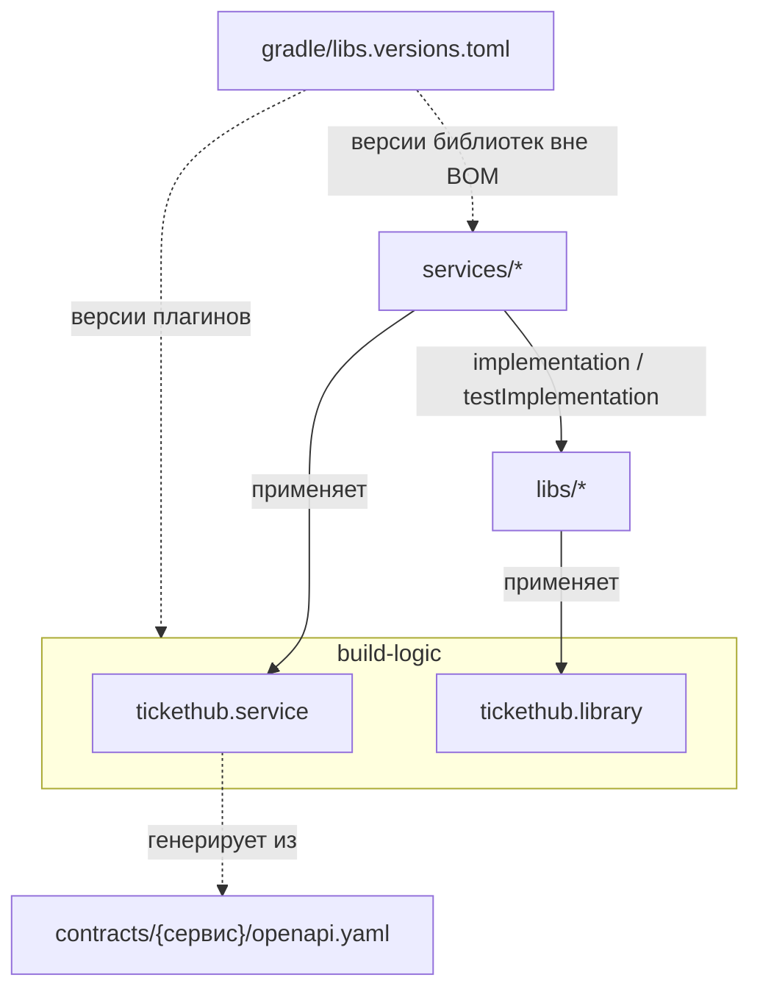
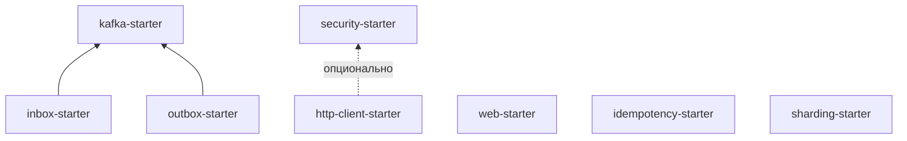

# Общие модули

Какие общие модули есть в проекте, кто их использует и по каким правилам они появляются. Код модулей лежит в `build-logic/` и `libs/`, контракты сервисов — в `contracts/` (правила — в `CLAUDE.md`, раздел «Контракты между сервисами»).

## Правила

- **Только техника.** В общих модулях нет доменных типов, DTO и портов сервисов. Порт объявляет сервис, стартер даёт технический API, мост между ними — адаптер в сервисе.
- **Выносить при втором использовании.** Пока у кода один пользователь, он живёт внутри сервиса.
- **Нарезка по причине изменения, а не по категории.** Модуль отвечает за одну тему целиком. Никаких `common-model`, `common-exception`, `common-utils`.
- **Общий код стартеров — у владельца понятия.** Если двум стартерам нужно одно и то же, оно живёт в том стартере, которому принадлежит понятие, а второй зависит от него. Отдельный узкий модуль (`kafka-api`) — только если естественного владельца нет.
- **Один модуль на стартер.** Автоконфигурация и код вместе, без деления на `*-autoconfigure` и `*-starter`. Пара `x-api` + `x-starter` выделяется только когда появился потребитель, которому нужны типы без автоконфигурации.
- **Зависимости только вниз, без циклов.** Если модули всегда меняются вместе, их стоит слить.

## Виды модулей

| Вид | Что это | Где |
| --- | --- | --- |
| Convention plugin | Правила сборки: версии, генерация кода, тестовые задачи | `build-logic/` |
| Starter | Runtime-код с автоконфигурацией | `libs/*-starter` |
| Библиотека для тестов | Подключается только в `testImplementation` | `libs/test-support`, `libs/architecture-rules` |

## Сборка

Монорепозиторий на Gradle с Kotlin DSL. Сервисы (`services/*`) и общие модули (`libs/*`) — подпроекты одной сборки. Общие модули подключаются как проекты (`implementation(projects.libs.webStarter)`), а не как опубликованные jar: репозитория артефактов нет.

`build-logic` — отдельная сборка, подключённая в корневом `settings.gradle.kts` через `pluginManagement { includeBuild("build-logic") }`. Gradle собирает её из исходников при каждой сборке, если она изменилась; публиковать плагины не нужно. Подпроект применяет плагин по id, корневого `build.gradle.kts` с `allprojects {}` или `subprojects {}` нет.

| Плагин | Для кого | Что делает |
| --- | --- | --- |
| `tickethub.service` | Сервисы | Java 25, Spring Boot (`bootJar`), BOM Spring Boot, actuator и observability, JUnit Platform. Если есть `contracts/<сервис>/openapi.yaml`, генерирует из него интерфейсы контроллеров и модели (`interfaceOnly`, без клиентов). Схема `Problem` из `contracts/common/problem.yaml` не генерируется, а отображается на `ProblemDetail` из Spring (`schemaMappings`) |
| `tickethub.library` | Модули `libs/` | Java 25, `java-library`, BOM Spring Boot, процессоры автоконфигурации, JUnit Platform |

Плагинов два, по одному на вид подпроекта. Несколько повторяющихся строк (toolchain, тесты) дешевле, чем общий базовый плагин.

Версии:

| Что | Где версия |
| --- | --- |
| Плагины Gradle (Spring Boot, OpenAPI Generator) | `gradle/libs.versions.toml`, подключаются в `build-logic/build.gradle.kts`; в подпроектах `id(...)` без версии |
| Spring и всё, что есть в BOM Spring Boot | BOM Spring Boot; в подпроектах без версии |
| Библиотеки вне BOM (MapStruct, ShedLock, …) | `gradle/libs.versions.toml`, в подпроекте `libs.xxx` |

`build-logic` читает тот же `gradle/libs.versions.toml` через `versionCatalogs` в своём `settings.gradle.kts`.

## Список

Этап — номер этапа в [plan.md](plan.md), на котором модуль выносится в `libs/`, то есть когда появляется второй пользователь. До этого код живёт внутри первого сервиса.

| Модуль | Что даёт | Этап | Первый → второй пользователь |
| --- | --- | --- | --- |
| `build-logic` | Два convention plugin: `tickethub.service` и `tickethub.library` (см. «Сборка») | 0 | Все сервисы и модули `libs/` |
| `test-support` | Testcontainers-конфигурации (PostgreSQL, Kafka, Redis, Keycloak), мета-аннотация `@IntegrationTest` вместо базового класса тестов ([ADR-019](adr/0019-composition-over-inheritance.md)), ожидание сообщения в топике, настройки Pact | 2 | Catalog → Reservation |
| `architecture-rules` | Два набора ArchUnit-правил: `layered()` и `hexagonal()`. Оба включают правило «без наследования классов проекта» ([ADR-019](adr/0019-composition-over-inheritance.md)). Код, сгенерированный из OpenAPI, из проверок исключён | 2 | Catalog → Reservation |
| `web-starter` | Ошибки в формате ProblemDetail (RFC 9457): `ErrorCode`, `Problems`, `GlobalErrorHandler`, `ProblemEnricher` (см. «Обработка ошибок»). `CursorCodec` для курсорной пагинации: переводит `ScrollPosition` из Spring Data в непрозрачный курсор и обратно, проверяет `limit`, на испорченный курсор отвечает 400 `INVALID_CURSOR` | 2 | Catalog → Reservation |
| `security-starter` | JWT resource server, конвертер ролей Keycloak, `CurrentUser`, client credentials для исходящих вызовов, правила доступа по группам эндпоинтов `/api`, `/admin`, `/internal` ([ADR-020](adr/0020-endpoint-groups.md)) | 3 | Order → Catalog, Reservation |
| `kafka-starter` | Сериализация, стандартные заголовки, дефолты консьюмеров и продюсера, retry-топики и DLT, объявление топиков из конфигурации. Retry-топики и DLT добавляются на этапе 4 | 2 | Catalog → Reservation |
| `outbox-starter` | `OutboxWriter`, таблица outbox и её миграция, polling publisher: один активный экземпляр через ShedLock, чтобы сохранить порядок событий агрегата | 3 | Catalog → Order |
| `idempotency-starter` | Фильтр Idempotency-Key: хранение ответа, гонка двух одинаковых запросов, 409 при другом теле | 3 | Order → Reservation |
| `inbox-starter` | Дедупликация консьюмеров, таблица inbox с ключом `(consumer, message_id)` и её миграция | 4 | Order → Notification |
| `http-client-starter` | Разбор ошибок в ProblemDetail, дефолтные таймауты, токен client credentials из `security-starter` | 5 | Order → Payment |
| `sharding-starter` | Роутинг `DataSource` по хэшу user_id, конфигурация шардов | 6 | Order → Payment |
| `observability-starter` | Общие настройки OpenTelemetry. Появится, только если настроек станет больше, чем помещается в convention plugin | по ситуации | — |

## Кто что использует

L — layered, H — hexagonal.

| Модуль | Catalog | Reservation | Order | Payment | Notification | Query | Gateway | Fake provider |
| --- | :---: | :---: | :---: | :---: | :---: | :---: | :---: | :---: |
| `build-logic` | ✓ | ✓ | ✓ | ✓ | ✓ | ✓ | ✓ | ✓ |
| `test-support` | ✓ | ✓ | ✓ | ✓ | ✓ | ✓ | ✓ | |
| `architecture-rules` | L | H | H | H | L | L | | |
| `security-starter` | ✓ | ✓ | ✓ | ✓ | | ✓ | ✓ | |
| `web-starter` | ✓ | ✓ | ✓ | ✓ | | ✓ | ✓ | |
| `kafka-starter` | ✓ | ✓ | ✓ | ✓ | ✓ | ✓ | | |
| `inbox-starter` | | ✓ | ✓ | | ✓ | | | |
| `outbox-starter` | ✓ | ✓ | ✓ | ✓ | | | | |
| `idempotency-starter` | | ✓ | ✓ | ✓ | | | | |
| `http-client-starter` | | | ✓ | ✓ | | | | |
| `sharding-starter` | | | ✓ | ✓ | | | | |

Почему так:

- **Catalog** первым получает Kafka и outbox: с этапа 1 он публикует `EventPublished` с числом мест ([ADR-018](adr/0018-seat-ownership.md)), позже — изменения каталога и отмену мероприятия. Инвалидация L1-кэша идёт после коммита, без outbox.
- **Reservation** принимает удержание мест от Order с ключом идемпотентности, публикует истечение брони через outbox, слушает отмену мероприятия через inbox. `EventPublished` он слушает без inbox: строки мест вставляются по ключу `(event_id, seat_no)`, и повтор события дублей не создаёт.
- **Order** использует почти всё: он принимает заказы с Idempotency-Key, вызывает Catalog, Reservation и Payment, слушает итог платежа и истечение брони, публикует события заказа и шардируется.
- **Payment** принимает вызовы Order с ключом идемпотентности, вызывает провайдера, публикует итог платежа, шардируется. Inbox ему не нужен: событий он не слушает, возврат при отмене мероприятия запрашивает Order ([ADR-012](adr/0012-event-cancellation-orchestration.md)).
- **Notification** — только консьюмер Kafka, REST у него нет.
- **Query** читает CDC из Kafka, но inbox ему не нужен: своей PostgreSQL нет, а запись в OpenSearch идемпотентна сама по себе (upsert по id с проверкой версии). В `test-support` для него понадобится контейнер OpenSearch.
- **Gateway** проверяет JWT и отдаёт собственные ошибки (401, 429) в формате ProblemDetail. Запросы он проксирует через Spring Cloud Gateway, поэтому `http-client-starter` ему не нужен. Gateway на MVC-варианте Spring Cloud Gateway ([ADR-013](adr/0013-servlet-stack.md)), поэтому `security-starter` и `web-starter` у него те же, что у остальных.
- **Fake provider** — внешняя система с точки зрения TicketHub, общих модулей кроме сборки не использует.

## Зависимости между модулями

`web-starter`, `idempotency-starter` и `sharding-starter` ни от кого не зависят.

## Обработка ошибок

Формат ошибки один для всех сервисов — Problem Details по RFC 9457, схема в `contracts/common/problem.yaml`. Формат целиком принадлежит `web-starter`, а какие ошибки бывают и какие у них коды — решает сервис.

| Где | Что |
| --- | --- |
| `web-starter` | `ErrorCode` — интерфейс: код, HTTP-статус, `title` |
| | `Problems` — собирает `ProblemDetail` из `ErrorCode` и `detail`, при необходимости с дополнительными полями |
| | `GlobalErrorHandler` — общие случаи: ошибки валидации → 400 с `errors: [{field, message}]`, нечитаемое тело → 400, неизвестное исключение → 500 без деталей наружу. Наследует `ResponseEntityExceptionHandler` (разрешено [ADR-019](adr/0019-composition-over-inheritance.md)) |
| | `ProblemEnricher` — `ResponseBodyAdvice`, который дописывает `traceId` и `instance` в любой `ProblemDetail`, кто бы его ни создал |
| Домен сервиса | Свои исключения без зависимостей от HTTP и стартеров: `EventNotFoundException`, `SeatAlreadyHeldException` |
| Веб-слой сервиса (`web/` в layered, `adapter/in/web/` в hexagonal) | Enum кодов, реализующий `ErrorCode`, и свой `@RestControllerAdvice`: одна строка на доменное исключение, `Problems.of(CatalogError.EVENT_NOT_FOUND, e.getMessage())` |

Правила:

- Доменный advice переиспользует стартер вызовом `Problems`, а не наследованием `GlobalErrorHandler`: наследник получил бы копию общих обработчиков.
- `GlobalErrorHandler` стоит последним (`@Order(Ordered.LOWEST_PRECEDENCE)`). Spring берёт первый advice с подходящим обработчиком, и общий «любое исключение → 500» иначе перехватил бы доменные ошибки. Тест в `web-starter`: при двух advice доменное исключение не превращается в 500.
- HTTP-статус появляется только в веб-слое. То же доменное исключение в консьюмере Kafka означает не 404, а пропуск события или DLT.
- Если доменных обработчиков станет много, следующий шаг — бин `ErrorCodeMapping` (исключение → `ErrorCode`), который читает `GlobalErrorHandler`. Тогда доменные advice не нужны. Вводится по ситуации, не раньше второго сервиса.

## Что намеренно не вынесено

| Кандидат | Почему нет |
| --- | --- |
| PostgreSQL, Redis | Spring Boot и Flyway покрывают подключение. Lua-скрипты и rate limit — логика конкретных сервисов |
| Кэширование | Используется только в Catalog, и это тема этапа 1. Стартер спрятал бы то, что изучается |
| Саги | Оркестратор один — Order ([ADR-003](adr/0003-purchase-saga-orchestration.md)). Обобщённый движок саг — это самодельный Temporal |
| UUIDv7, ShedLock | Достаточно зависимости. ShedLock подключают `outbox-starter` и сервисы с задачами по расписанию |
| Общие модели и исключения | Доменные типы у каждого сервиса свои, DTO генерируются из контрактов, обработка ошибок — в `web-starter`. Формат ошибки — стандартный `ProblemDetail` из Spring, своего класса `GeneralError` нет |
| Общий справочник кодов ошибок | Каждый новый код в любом сервисе менял бы общую библиотеку. Коды — enum сервиса, в `web-starter` только интерфейс `ErrorCode`; потребитель сам решает, на какие коды владельца реагировать |
| Общие исключения (`NotFoundException`, `ConflictException`) | Их бросает домен, и он стал бы зависеть от веб-стартера, то есть от HTTP; `hexagonal()` это запрещает. К тому же общее исключение всё равно требует конкретного кода (`EVENT_NOT_FOUND`), и от него остаётся только статус. Если понадобится нейтральная категория ошибки без HTTP, она выносится в отдельный модуль на чистой Java (`error-api`), а не в `web-starter` |
| Тип страницы (`Page<T>`) | Сервисный слой зависел бы от веб-стартера. Репозиторий и сервис используют `Window<T>` и `ScrollPosition` из Spring Data; `CursorCodec` переводит их в курсор только в контроллере. Можно ли порту hexagonal-сервиса возвращать `Window`, решается на этапе 2 |

## Открытые вопросы

- Формат payload в outbox: сериализованный Avro или JSON с конвертацией в Debezium. Решается на этапе 4, ADR-004; на этапе 3 payload в JSON. До этого API `OutboxWriter` принимает `Object`, а сериализация спрятана внутри стартера.
